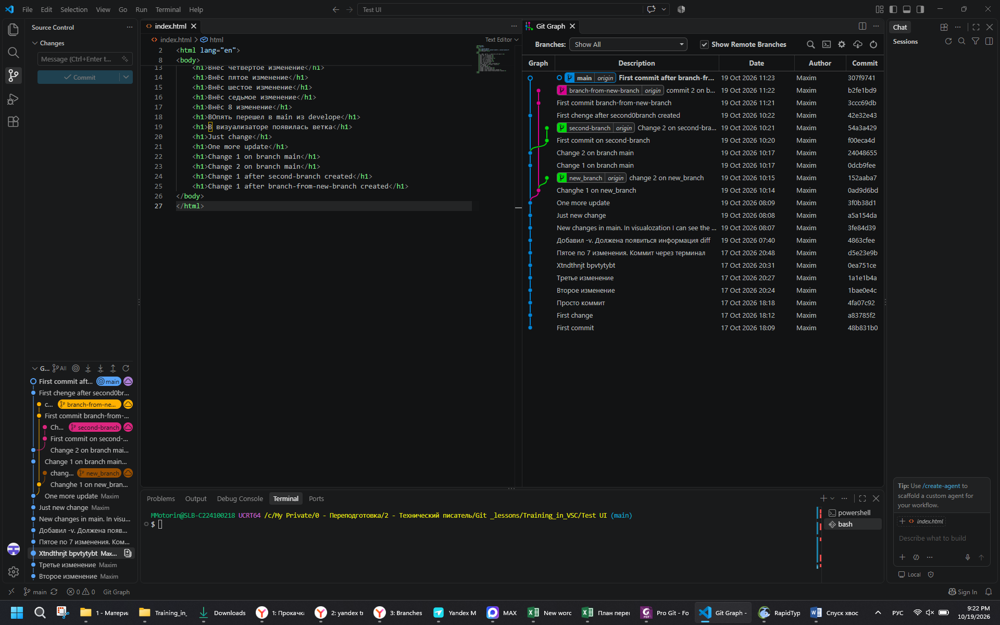
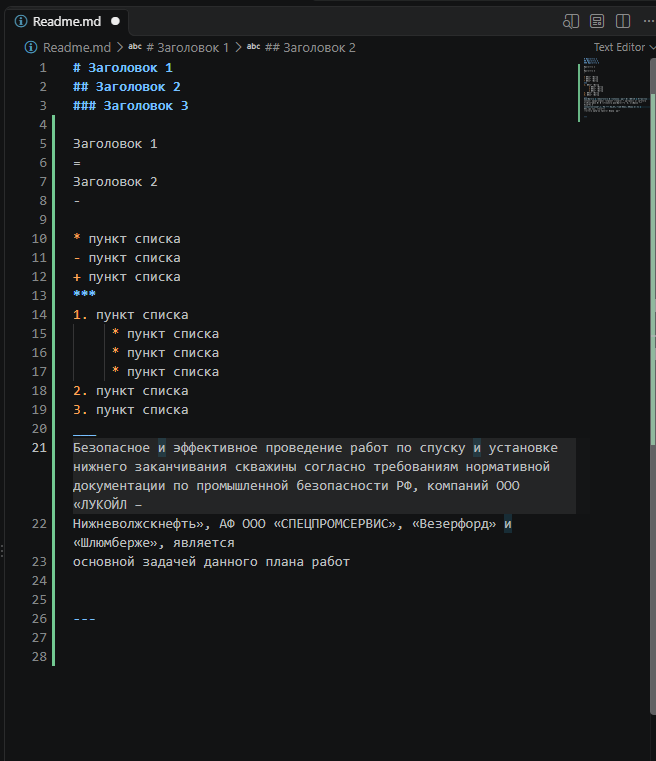

# Заголовок 1
## Заголовок 2
### Заголовок 3

Заголовок 1
=
Заголовок 2
-

* пункт списка
- пункт списка
+ пункт списка
***
1. пункт списка
     * пункт списка
     * пункт списка
     * пункт списка
2. пункт списка
3. пункт списка
___
Безопасное и ***эффективное*** проведение *работ* по спуску и установке нижнего заканчивания скважины __согласно__ требованиям нормативной документации по промышленной безопасности РФ, компаний ООО «ЛУКОЙЛ – 
Нижневолжскнефть», АФ ООО «СПЕЦПРОМСЕРВИС», «Везерфорд» и «Шлюмберже», является
основной задачей данного плана работ

___

>Зарегистрировать вес компоновки на бурение при движении вверх/вниз на забое и в интервале предположительной установки головы хвостовика (без вращения). Зарегистрировать свободный момент вращения транспортной колонны 10 об/мин, и вес на глубине установки головы хвостовика. 

***
```
ООО «ЛУКОЙЛ – Нижневолжскнефть»  
АФ ООО «СПЕЦПРОМСЕРВИС»  
«Везерфорд» и «Шлюмберже»  
```
---
[Ссылка на текст](google.com)



[](google.com)


Наименование  |  Количество  |  Примечания    
:-------------|:------------:|:------------:  
Пылесос       |  230         |       Samsung     
Утюг          | 200          |  _Dexter_      
Сапоги        | 190          | __Columbia__

